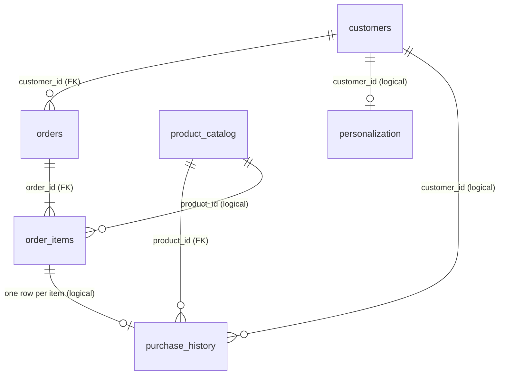

# Database Schema Overview

One Neon Postgres database (`neondb`), **one schema per agent**. Created and seeded by `scripts/neon-db-creation/init_neon.py` from the H&M mini dataset in `data/H_and_M_mini_dataset/csv-format/` (see `DOCS/data/data-info.md`).

| Schema | Agent | Tables |
|---|---|---|
| `order_management` | Order management | `customers`, `orders`, `order_items` |
| `product_recommendation` | Product recommendation | `product_catalog`, `purchase_history` |
| `personalization` | Personalization | `personalization` |

Shared IDs: customers `cust001`..`cust005`, products `prod001`..`prod010`. The original H&M ids are kept in `customers.hm_customer_id` and `product_catalog.article_id`.

## How the dataset is mapped

The dataset has articles, customers and transactions only. It has no order ids, order status, shipping, stock, names or contact details, so these are **derived**, never invented:

| Derived | Rule |
|---|---|
| Ids | `custNNN`: most purchases first, then file order. `prodNNN`: `articles.csv` order. |
| Orders | One order per (customer, purchase date): same-day purchases are one basket. `ORD-1001`.. in date, then customer order. |
| Order items | One per transaction (`quantity` 1). |
| Status | All `delivered` (shipping `delivered`, no return): every transaction is historical. `delivery_date` is NULL because it is not recorded. |
| `price` | The dataset's normalized price, not a currency amount. Never quote it to customers. |
| Not present | Names, emails, addresses, stock levels, ratings. The old `inventory` table is gone for this reason. |

---

## `order_management`

### `customers`: who the customer is
| Column | Type | Notes |
|---|---|---|
| `customer_id` | VARCHAR(50) | **PK** (`cust001`..) |
| `hm_customer_id` | VARCHAR(64) | unique, original anonymized H&M id |
| `club_member_status` | VARCHAR(30) | `ACTIVE` / `PRE-CREATE` / `LEFT CLUB` |
| `fashion_news_frequency` | VARCHAR(30) | `NONE` / `Regularly` / `Monthly` |
| `fashion_news_subscriber`, `active` | BOOLEAN | from `FN` / `Active` (null in the CSV means no) |
| `age` | INTEGER | 0-120 or NULL |
| `postal_code` | VARCHAR(64) | hashed |
| `created_at`, `updated_at` | TIMESTAMP | audit |

### `orders`: one row per order
| Column | Type | Notes |
|---|---|---|
| `order_id` | VARCHAR(50) | **PK** (e.g. `ORD-1007`) |
| `customer_id` | VARCHAR(50) | **FK** → `customers.customer_id` |
| `order_status` | VARCHAR(50) | `processing` / `shipped` / `delivered` / `cancelled` |
| `shipping_status` | VARCHAR(50) | `preparing` / `in_transit` / `delivered` / `cancelled` |
| `return_exchange_status` | VARCHAR(50) | `return_requested` / `exchange_completed`; only when `delivered` |
| `sales_channel` | VARCHAR(20) | `store` / `online` (from `sales_channel_id` 1 / 2) |
| `order_date` | DATE | required (`t_dat`) |
| `delivery_date` | DATE | NULL when not recorded; must be NULL when cancelled |
| `created_at`, `updated_at` | TIMESTAMP | audit |

### `order_items`: the items in an order
| Column | Type | Notes |
|---|---|---|
| `order_id`, `line_no` | VARCHAR(50), INTEGER | **PK**; `order_id` is a **FK** → `orders.order_id` |
| `product_id` | VARCHAR(50) | `prodNNN` (logical link to the catalog, see below) |
| `product_name` | VARCHAR(255) | denormalized copy of the catalog name |
| `quantity` | INTEGER | `> 0`, default 1 |
| `price` | NUMERIC(12,9) | normalized price, `>= 0` |

Indexes: `orders(customer_id)`, `orders(order_status)`, `orders(order_date)`.

---

## `product_recommendation`

### `product_catalog`: one row per article
| Column | Type | Notes |
|---|---|---|
| `product_id` | TEXT | **PK** (`prod001`..) |
| `article_id` | TEXT | unique, original 10-digit H&M id (keeps leading zeros) |
| `product_code` | TEXT | first 7 digits, shared by colour variants |
| `product_name` | TEXT | `prod_name` |
| `product_type`, `product_group` | TEXT | e.g. Blazer / Garment Upper body |
| `colour`, `perceived_colour` | TEXT | colour group / perceived master colour |
| `department`, `section`, `garment_group`, `index_group` | TEXT | merchandising hierarchy |
| `description` | TEXT | `detail_desc`; NULL for some articles (text for embeddings) |

### `purchase_history`: what each customer bought
| Column | Type | Notes |
|---|---|---|
| `id` | SERIAL | **PK** |
| `customer_id` | TEXT | required (no FK, see below) |
| `product_id` | TEXT | **FK** → `product_catalog.product_id` |
| `purchase_date` | DATE | required |
| `price` | NUMERIC(12,9) | normalized price |
| `sales_channel` | TEXT | `store` / `online` |

---

## `personalization`

### `personalization`: customer profile (one row per customer)
| Column | Type | Notes |
|---|---|---|
| `customer_id` | TEXT | **PK** (no FK, see below) |
| `age` | INTEGER | |
| `club_member_status`, `fashion_news_frequency` | TEXT | as in `customers` |
| `fashion_news_subscriber`, `active` | BOOLEAN | |
| `top_product_group` | TEXT | **derived**: most frequent product group in the customer's purchases (NULL if none) |
| `purchase_count` | INTEGER | **derived**: number of purchases |

---

## How everything connects

### Enforced links (foreign keys, inside one schema only)
- `orders.customer_id` → `customers.customer_id`
- `order_items.order_id` → `orders.order_id`
- `purchase_history.product_id` → `product_catalog.product_id`

### Logical links (across schemas, by shared ID, no database constraint)
Agents stay independent, so there are **no cross-schema foreign keys**. Instead the same IDs are reused:

| From | To | Join key |
|---|---|---|
| `personalization.personalization` | `order_management.customers` | `customer_id` |
| `product_recommendation.purchase_history` | `order_management.customers` | `customer_id` |
| `order_management.order_items` | `product_recommendation.product_catalog` | `product_id` (name must match) |
| `product_recommendation.purchase_history` | `order_management.order_items` | one history row per item (same customer, product, date, price) |
| `personalization.personalization` | `product_recommendation.purchase_history` | `purchase_count` equals the customer's history rows |

`init_neon.py` runs `check_consistency()` after seeding to verify these rules, since the database does not.

### Mental model
- `customers.customer_id` is the customer key everywhere; `product_catalog.product_id` is the product key everywhere.
- `product_catalog` is the source of truth for product attributes. `order_items` holds a copy of the name.
- `purchase_history` mirrors `order_items`; both come from the same transactions.
