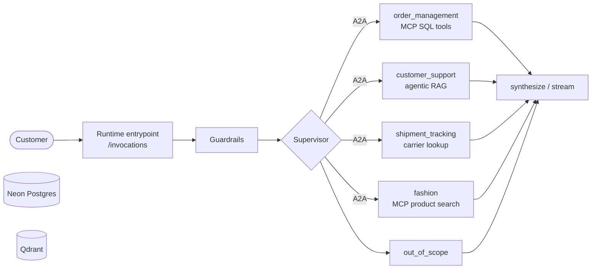

# H&M Assistant

A multi-agent assistant for H&M, built with LangGraph. A supervisor reads each
message and routes it to one of four sub-agents. The agents
run as separate A2A services, and an AgentCore-style entrypoint exposes the assistant over HTTP with streaming.



## Tech stack

| Area | Technology |
|---|---|
| Orchestration | LangGraph, LangChain |
| LLM | Groq (`openai/gpt-oss-20b`, `openai/gpt-oss-120b`) |
| Agent protocols | A2A (`a2a-sdk`), MCP (`mcp`, `langchain-mcp-adapters`) |
| Runtime | AWS Bedrock AgentCore SDK, Uvicorn, Docker |
| Database and checkpointer | Neon Postgres (`psycopg`, `PostgresSaver`) |
| Vector store and embeddings | Qdrant, `fastembed` (`BAAI/bge-small-en-v1.5`) |
| Auth | Auth0 (JWT), optional SigV4 for agent calls |
| Guardrails | Amazon Bedrock Guardrails |
| Tracing and prompts | Langfuse |
| Evaluation | RAGAS, DeepEval, deterministic metrics |
| Logging | Python `logging`, CloudWatch (`watchtower`) |


## Project layout

```
src/hm_agent/
  cli.py            CLI entry point (single query and chat loop)
  graph.py          Supervisor graph assembly
  turns.py          One-message turn logic shared by the CLI and the runtime entrypoint
  runtime/          AgentCore entrypoint (/invocations, /ping) and thread ownership/history helpers
  auth/             Auth0 JWT verification and a standalone login app
  core/             Shared config, LLM factory, logging, tracing, prompt defaults, db and graph state
  prompt_registry.py Loads versioned prompts from Langfuse, falling back to the code constants
  guardrails/       Bedrock Guardrails client (input and output screening)
  evals/            Offline / Online evaluation
  supervisor/       Route to sub-queries
  order_management/ Agent, MCP server and client (injects customer_id), A2A service
  customer_support/ Agent, RAG pipeline (rag/), A2A service
  shipment_tracking/ Dummy carrier lookup agent (streams progress, push notifications), A2A service
  fashion/          Agent, MCP server and client (product search, styling guides), A2A service
  a2a/              A2A server, client, cards, stream chunks, push receiver and supervisor remote node
tests/              Unit and entrypoint tests (fakes, no live services)
data/evals/         golden.jsonl, the 10-item golden evaluation set
config/             base.yaml, dev.yaml
scripts/            Userful scripts for creating langfuse, ingestion, guardrail
DOCS/               Code documentation
```

## Setup

Requires Python 3.11+ and [uv](https://docs.astral.sh/uv/).

```bash
uv sync
cp .env.example .env        # then fill in the values
```

| Variable | Used for |
|---|---|
| `GROQ_API_KEY` | LLM calls (Groq free tier, rate limited) |
| `NEON_POSTGRES_CONNECTION_STRING` | Order data and the conversation checkpointer |
| `NEON_POSTGRES_TEST_CONNECTION_STRING` | Separate test database (`neondb_test`); tests never use the main DSN |
| `QDRANT_ENDPOINT`, `QDRANT_API_KEY` | Vector store for the support knowledge base |
| `LANGFUSE_PUBLIC_KEY`, `LANGFUSE_SECRET_KEY`, `LANGFUSE_BASE_URL` | Tracing, prompt registry and evaluation |
| `GUARDRAILS_ENABLED`, `BEDROCK_GUARDRAIL_ID`, `BEDROCK_GUARDRAIL_VERSION` | Optional Bedrock guardrail (off by default) |

Seed the database (one schema per agent; `--reset` rebuilds, `--test` targets the test database):

```bash
uv run python scripts/neon-db-creation/init_neon.py
```

The support agent expects a Qdrant collection named `troubleshooting_kb` (see `config/base.yaml`),
embedded with `BAAI/bge-small-en-v1.5`.

The fashion agent searches a second collection, `product_catalog`, built from the Neon `product_catalog`
table (recreated on every run):

```bash
uv run python scripts/fashion/ingest_catalog.py
```

## Usage

The supervisor reaches each agent over A2A, so start the agent services first (one process each,
ports in `config/base.yaml`) in a separate terminal and leave them running:

```bash
uv run python scripts/a2a/run_agents.py
```

This starts the fashion MCP server (port 8005, so its embedding model loads once) and the order management,
customer support, shipment tracking and fashion services (ports 8001 to 8004). The push-notification receiver
on 8010 is run by the supervisor side. H

Agent replies stream end to end: runners yield chunks, the A2A server sends them as progress and
artifact updates, and the supervisor forwards them to the caller. For slow tasks, if the stream breaks,
the agent pushes the result to the webhook and it is saved into the same thread.

### Interactive chat (continuous conversation)

Run without a query to chat over many turns in one session. Every message uses the same
`thread_id`, so the assistant remembers earlier turns ("what about the one before that?").
Type `exit`, `quit` or press Ctrl+C to leave.

```bash
uv run python -m hm_agent
uv run python -m hm_agent --customer-id cust002
```

### Single query

```bash
uv run python -m hm_agent "What was the last item I bought?"
```

### Resume a conversation later

The `thread_id` is printed at the start of a chat and when the process ends. Pass it back to
continue where you left off (history is loaded from the Neon checkpointer):

```bash
uv run python -m hm_agent --thread-id <thread_id>
uv run python -m hm_agent --thread-id <thread_id> "And how many items have I bought in total?"
```

| Flag | Default | Meaning |
|---|---|---|
| `query` (positional, optional) | none | One message. Omit it to start the chat loop. |
| `--customer-id` | `cust001` | Customer the conversation belongs to (`cust001`..`cust005` in the seed data). |
| `--thread-id` | new UUID | Existing thread to resume. |

If you build an API or UI on top, keep one stable `thread_id` per conversation and call
`graph.invoke` once per message; the chat loop is only needed for the CLI.

### RAG pipeline on its own

```bash
uv run python -m hm_agent.customer_support.rag "What happens if my package can't be delivered?"
```

## Runtime entrypoint

`runtime/entrypoint.py` is the supervisor's front door, built with the AgentCore SDK (it replaced the
earlier FastAPI layer). Start the agent services first, then:

```bash
RUNTIME_PORT=8090 uv run python -m hm_agent.runtime.entrypoint
curl -N -X POST localhost:8090/invocations -H 'Content-Type: application/json'   -H 'X-Amzn-Bedrock-AgentCore-Runtime-Session-Id: local-session-000000000000000001'   -d '{"message": "Where is my order ORD-1001?", "customer_id": "cust001"}'
```

| Endpoint | Purpose |
|---|---|
| `POST /invocations` | `{"message": "..."}` runs one chat turn; `{"action": "history"}` reads the thread back. Streams JSON events and always ends with `done`. |
| `GET /ping` | Health check. |

The runtime session id header is the conversation `thread_id`. With `AUTH_ENABLED=true` the customer id comes
only from the verified Auth0 bearer token (the body's `customer_id` is ignored) and a thread belongs to the
customer who created it. Port, pool size and message limit are under `runtime:` in `config/base.yaml`.

`docker compose up --build` runs the supervisor (host port 8090) and the four agents as arm64 containers;
secrets come from `.env` at run time.

## Tests

Tests use fakes for the graph, the LLM and Neon, so they make no Groq calls:

```bash
uv run pytest
```

## Prompts, evaluation and monitoring (Langfuse)

Prompts are versioned in Langfuse (`hm/<role>`; the code constants are the fallback), every turn is one trace
across supervisor and agents with online scores (latency, tools, safety, cost), and a 10-item golden set is
evaluated offline with deterministic metrics, RAGAS and DeepEval.

```bash
uv run python scripts/langfuse/sync_prompts.py          # push prompt defaults (idempotent)
uv run python scripts/langfuse/sync_dataset.py          # upload data/evals/golden.jsonl
uv run --group evals python -m hm_agent.evals --metrics det --limit 3   # cheap smoke run, no judge calls
```

## Guardrails (Amazon Bedrock)

An optional guardrail screens the customer message before the graph runs and the final reply before it is
returned: toxicity, prompt-injection attempts, PII masking (email, phone, address) and blocked card numbers.
It uses the model-independent `ApplyGuardrail` API, so cost is per screened text unit and there is no running
cost. It is off by default (`guardrails.enabled: false` in `config/base.yaml`). A blocked input is refused with
`guardrails.blocked_reply`; if the input check is unavailable the turn is refused (`fail_closed_input`), while
the output check always fails open. Only category names and counts are logged, never the text.

To turn it on, after local tests pass:

```bash
uv run python scripts/aws/create_guardrail.py     # prints the guardrail id
# then set BEDROCK_GUARDRAIL_ID in .env and GUARDRAILS_ENABLED=true
```

## Configuration

Layered YAML in `config/`: `base.yaml` holds the defaults and `dev.yaml` is merged over it
(`APP_ENV=dev` is the default). Model names per role, RAG settings, history window sizes, log level
and tracing tags live there, not in code.

| Role | Model |
|---|---|
| Small | `openai/gpt-oss-20b` |
| Big | `openai/gpt-oss-120b` |

Secrets never go in the YAML files; they live in `.env`.

## Notes

- Run and test locally before touching AWS, and keep any AWS resources minimal and pay-per-use.
- Logs use `key=value` fields and never include secrets or customer data.
